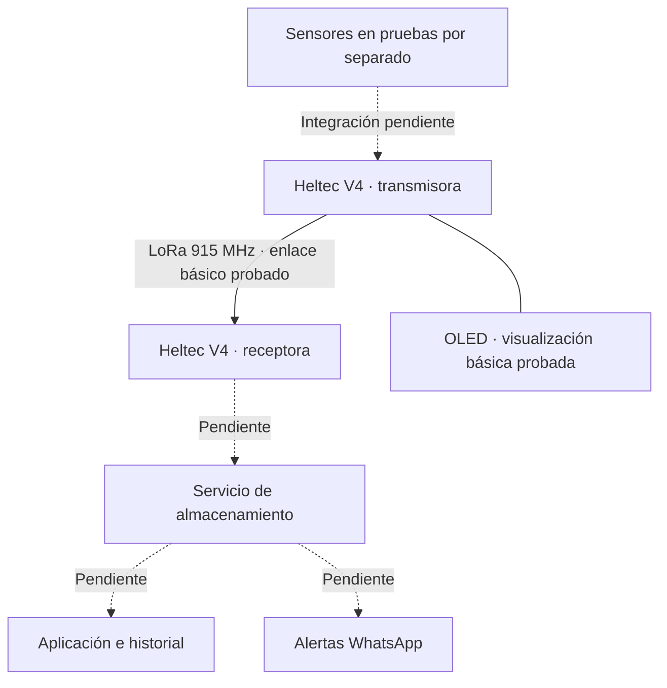

# Arquitectura y estado de YakuToring

**Equipo 09 · Actualizado: 29/10/2026 · Documento de trabajo**

Este esquema resume el sistema **sin presentar las funciones futuras como terminadas**. El diseño conceptual previo se conserva en [Caja negra, esquema de funciones y matriz morfológica](../Proyecto%20Integrador/Talleres/CajaNegra_EsquemaFunciones_MatrizMorfologica.md).

## Parte comprobada y parte propuesta

**Lo comprobado hasta ahora:** comunicación inicial entre dos Heltec WiFi LoRa 32 V4, lectura/visualización en OLED y pruebas aisladas de sensores. No equivale a una prueba de funcionamiento permanente, alcance garantizado ni adquisición simultánea [1].

**En implementación:** lectura conjunta de temperatura, pH, señal del módulo TDS y presión; verificación de GPIO y compatibilidad con ESP32-S3; envío de un mensaje estructurado con identificación de la medición; descarte de valores no válidos.

**Etapas futuras:** almacenamiento histórico con fecha/hora fiable, interfaz móvil/escritorio, predicción de OD operativa, alertas WhatsApp, panel solar y despliegue en boya. Se trata de objetivos, no de resultados actuales.

## Recorrido esperado de una medición

1. Alimentar los sensores y esperar su estabilización, con tiempos por determinar en las pruebas.
2. Tomar **cinco lecturas por sesión**, según el plan de una sesión cada hora.
3. Comprobar valores imposibles, fallas de lectura y variaciones anormales sin corregir artificialmente los datos.
4. Consolidar o conservar las cinco lecturas con un criterio documentado, todavía por acordar.
5. Enviar la información por LoRa y verificar recepción; el formato del paquete se definirá al estabilizar el firmware.
6. Registrar las lecturas y calcular el OD **solo cuando** exista integración y validación del modelo correspondiente.

## Límites y decisiones abiertas

- **Heltec V4:** confirmar en su documentación oficial qué GPIO están expuestos y cuáles utiliza el propio equipo. Los pines del ESP32 DevKit anterior no son un mapa definitivo [1], [2].
- **Calidad de datos:** un voltaje analógico no constituye por sí solo una medida calibrada de pH, conductividad o salinidad [3], [4].
- **Conectividad:** LoRa no proporciona por sí solo subida a Internet. El receptor necesitará una vía adicional validada.
- **Energía:** power bank de 5 V durante las pruebas; panel USB de 5 W y desconexión de sensores sujetos a ensayo.

Las fichas se encuentran en [Sensores](Modulo%20Electronico/Sensores.md), el seguimiento del hardware en [Componentes](Componentes.md) y la ejecución de ensayos en [Plan de pruebas](Plan_de_pruebas.md).

## Referencias (formato IEEE)

[1] Heltec Automation, “WiFi LoRa 32,” *Documentación técnica del fabricante*. [En línea]. Disponible: https://docs.heltec.org/en/node/esp32/wifi_lora_32/index.html. [Accedido: 29-oct-2026].

[2] Espressif Systems, “Analog to Digital Converter (ADC) — ESP32-S3,” *ESP-IDF Programming Guide*. [En línea]. Disponible: https://docs.espressif.com/projects/esp-idf/en/stable/esp32s3/api-reference/peripherals/adc/index.html. [Accedido: 29-oct-2026].

[3] U.S. Geological Survey, “Chapter A6.4. Measurement of pH,” *Techniques and Methods*, libro 9, cap. A6.4, 2021, doi: 10.3133/tm9A6.4.

[4] U.S. Geological Survey, “Chapter A6.3. Specific Conductance,” *Techniques and Methods*, libro 9, cap. A6.3, 2019, doi: 10.3133/tm9A6.3.
